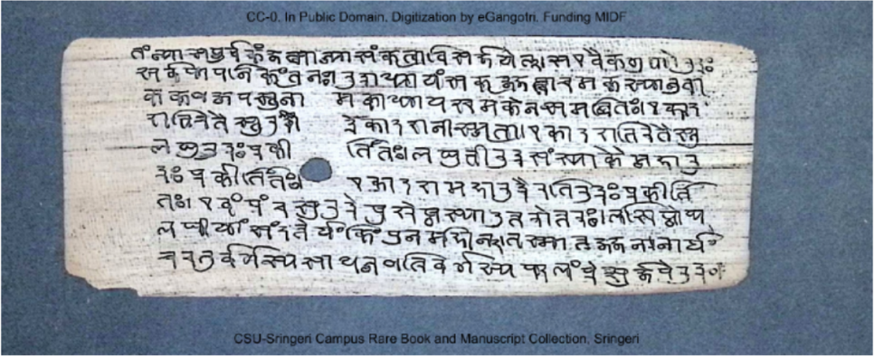
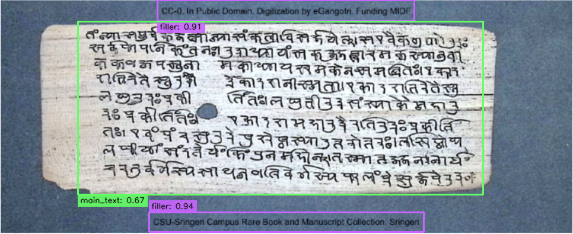
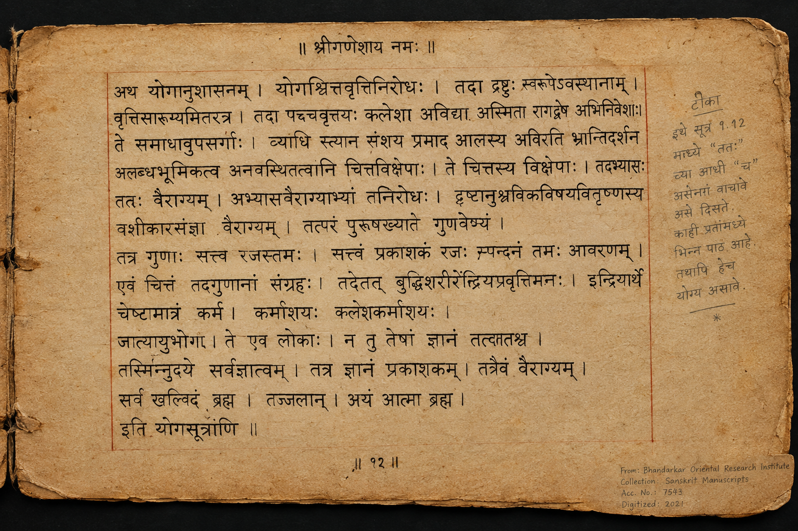
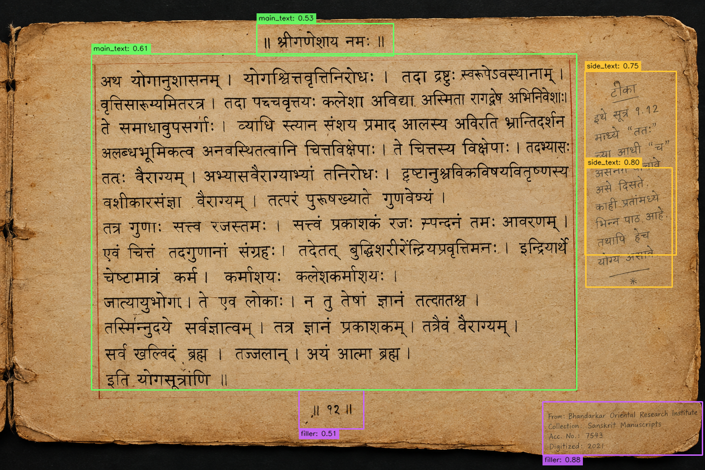
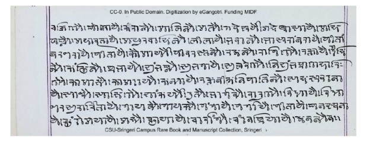
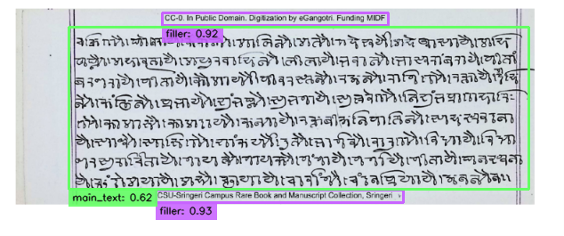

# Manuscript Layout Region Detection

A robust, production-ready document layout analysis pipeline designed for historical Indian manuscripts (palm-leaf folios, birch bark, and paper codices). The system maps complex manuscript visual elements and reading flows into five standardized target layout classes using deep learning layout priors, fine-grained text line detection, reading-flow graph analysis, and multilingual script discrimination.

---

## Table of Contents

1. [Project Title](#manuscript-layout-region-detection)
2. [Assignment Overview](#assignment-overview)
3. [Target Classes](#target-classes)
4. [Solution / Model Rationale](#solution--model-rationale)
5. [System Architecture](#system-architecture)
6. [Repository Structure](#repository-structure)
7. [Requirements](#requirements)
8. [Installation / Setup](#installation--setup)
9. [Model Initialization and First Run](#model-initialization-and-first-run)
10. [CLI Usage](#cli-usage)
11. [CLI Arguments](#cli-arguments)
12. [Input Requirements](#input-requirements)
13. [Output Structure](#output-structure)
14. [JSON Metadata Format](#json-metadata-format)
15. [Visual Examples](#visual-examples)
16. [Processing Workflow](#processing-workflow)
17. [Testing](#testing)
18. [Robustness / Supported Conditions](#robustness--supported-conditions)
19. [Constraints / Data Integrity](#constraints--data-integrity)
20. [Limitations](#limitations)
21. [Troubleshooting](#troubleshooting)
22. [Assignment Compliance](#assignment-compliance)

---

## Assignment Overview

Historical manuscripts pose distinct layout recognition challenges that standard document analysis models cannot solve out of the box:
- **Extreme Aspect Ratios:** Elongated palm-leaf folios (*Grantha*, *Nandinagari*, *Sharada*) often have aspect ratios ranging from 4:1 to over 8:1, while paper codices follow portrait or landscape proportions.
- **Physical Degradation:** Faded ink, show-through (bleed-through from reverse folio sides), water stains, edge fraying, and background paper discoloration.
- **Complex Multi-Tier Layouts:** Core root verses surrounded by interlinear glosses, side margin commentary columns, running chapter headers, and colophons.
- **Modern Contamination:** Digital library watermarks, modern English/Latin cataloguer attribution lines (e.g., funding notes, public domain statements), and library institutional stamps.

The objective of this project is to provide a clean, modular Python CLI solution that processes single images or batch directories, detects all manuscript layout regions, classifies them strictly into five target classes, exports visual annotations with distinct bounding boxes, and generates structured JSON metadata conforming to a strict production contract.

---

## Target Classes

Every detected region is mapped strictly to one of the five assignment-mandated classes:

| Class | Layout Role | Description |
|---|---|---|
| **`header`** | Running Header / Title | Top-of-page running title, section banner, chapter heading, or invocatory heading positioned above the central body. |
| **`footer`** | Colophon / Page Marker | Bottom-of-page scribal colophon, signature, catchword, pagination marker, or folio number. |
| **`side_text`** | Marginal Commentary | Independent marginal commentary, glosses, footnotes, or annotations flanking the main text block in the side margins. |
| **`main_text`** | Manuscript Body Text | Primary central manuscript reading body (supports single-column and multi-column reading flows). |
| **`filler`** | Modern / Non-Manuscript Element | Modern English/Latin cataloguer attributions, digital library metadata banners, institution collection stamps, empty non-text blocks, or decorative page borders. |

---

## Solution / Model Rationale

### 1. Macro Layout Prior: PP-DocLayoutV2
- **Component:** `paddleocr.LayoutDetection(model_name='PP-DocLayoutV2')`
- **Rationale:** Pretrained on large-scale diverse document layout benchmarks (DocLayNet, PubLayNet). It generates high-recall macro candidate proposals for text blocks, paragraph titles, tables, seals, and illustrations across diverse document compositions.
- **Role in Pipeline:** Serves as a primary structural prior. Its macro proposals guide region discovery but are never directly accepted as final bounding boxes without verification.

### 2. Fine-Grained Text Line Detection: PP-OCRv5_mobile_det
- **Component:** `FullPageTextDetector` wrapping DBNet (`PP-OCRv5_mobile_det`) via PaddleX
- **Rationale:** Pretrained document layout models frequently lump separate marginal commentary, header lines, and modern attribution banners into one oversized "text" box. To counter this, `PP-OCRv5_mobile_det` detects individual text lines across the uncropped image at native resolution.
- **Role in Pipeline:** Extracts fine-grained line-level geometry, line heights, and baseline coordinates that serve as atomic building blocks for reading-flow reconstruction.

### 3. Multilingual Script Recognition: devanagari_PP-OCRv5_mobile_rec
- **Component:** `paddleocr.TextRecognition(model_name='devanagari_PP-OCRv5_mobile_rec')` (with fallback to `PP-OCRv6_medium_rec`)
- **Rationale:** A visual bounding box alone cannot reveal whether a line is ancient Sanskrit verse or modern English digitization metadata. The recognizer extracts character content from marginal text lines and evaluates Unicode script distributions (Devanagari vs. Latin alphabet ranges).
- **Role in Pipeline:** Enables semantic gating. When text contains Latin script or attribution keywords (e.g., `"CC-0"`, `"Public Domain"`, `"Digitization"`, `"Funding"`, `"MIDF"`, `"Collection"`), it is classified with high confidence as **`filler`**, protecting **`main_text`** from absorbing external text.

### 4. OpenCV Image Preprocessing & Coordinate Tracking
- **Component:** `src/preprocessor.py`
- **Rationale:** Historical scans exhibit severe skew, low contrast, and varied EXIF orientations. OpenCV provides deterministic, low-overhead algorithms (Hough line deskewing, LAB CLAHE contrast enhancement, EXIF orientation rotation, and isometric letterboxing).
- **Role in Pipeline:** Normalizes the visual signal while tracking transformation matrices so all final coordinates are mathematically restored to the original image coordinates.

### 5. Adaptive Reading-Flow Analysis & Region Reconstruction
- **Component:** `src/region_reconstructor.py`
- **Rationale:** Fixed pixel thresholds fail across manuscripts scanned at different DPIs (e.g., 150 DPI vs 600 DPI). The reconstructor dynamically derives document-specific metrics: median line height ($H_{\text{line}}$), vertical inter-line spacing ($G_{\text{vert}}$), and page content boundaries.
- **Role in Pipeline:** Clusters lines sharing horizontal baselines, detects vertical column gutters, and links lines into sequential reading flows. Lines isolated outside the dominant flow (such as bottom attribution lines) are protected from being merged into the body text.

### 6. Semantic Ownership & Non-Overlap Enforcement
- **Component:** `src/semantic_refiner.py`
- **Rationale:** Prevents bounding box overlap and cross-flow bleed. Each detected text line is assigned to an exclusive structural owner.
- **Role in Pipeline:** Reconstructs tight bounding boxes from owned lines only, trimming empty whitespace. Guarantees that **`main_text`** and **`filler`** regions never overlap.

### 7. Post-Processing, Container Suppression & Boundary Validation
- **Component:** `src/postprocessor.py`
- **Rationale:** Resolves redundant macro proposals and guarantees mathematical coordinate validity.
- **Role in Pipeline:** Suppresses parent containers when child components are detected, applies class-aware Non-Maximum Suppression (IoU deduplication), isolates dominant ink bands to prevent boundary inflation, and strictly clamps all coordinates to image boundaries $[0, W] \times [0, H]$.

*Note on Model Claims:* All models use verified upstream pretrained weights from PaddleOCR and PaddleX. No custom fine-tuning or custom-trained weights are claimed.

---

## System Architecture

The end-to-end execution flow inside `inference.py` and `src/`:

```
Input (Single Image or Batch Directory)
  │
  ▼
[1] Image Validation & Preprocessing (src/preprocessor.py)
  ├── cv2.imread BGR validation
  ├── EXIF orientation tag auto-rotation
  └── Optional: Hough transform deskewing (±15°) & CLAHE contrast enhancement
  │
  ▼
[2] Dual-Source Feature Extraction
  ├── Macro Layout Proposals: PP-DocLayoutV2 (paddleocr.LayoutDetection)
  └── Fine-Grained Line Detection: PP-OCRv5_mobile_det (PaddleX DBNet)
  │
  ▼
[3] Multilingual Script Recognition & Attribution Gating (src/semantic_refiner.py)
  ├── Character recognition via devanagari_PP-OCRv5_mobile_rec
  ├── Unicode script ratio calculation: Devanagari vs. Latin
  └── Attribution keyword matching ("CC-0", "Digitization", "Funding", etc.)
  │
  ▼
[4] Internal Reading-Flow Analysis (src/region_reconstructor.py)
  ├── Document line metrics derivation (H_line, G_vert)
  ├── Content frame and vertical gutter discovery
  ├── Baseline clustering & sequential reading-flow graph linking
  └── Isolated top/bottom group protection
  │
  ▼
[5] Semantic Ownership & Region Reconstruction (src/semantic_refiner.py)
  ├── Exclusive line-to-region ownership assignment
  ├── Tight envelope reconstruction with adaptive padding
  └── Strict non-overlap guarantee between main_text and filler
  │
  ▼
[6] Post-Processing & Boundary Validation (src/postprocessor.py)
  ├── Container suppression & class-aware NMS deduplication
  ├── Dominant ink-band projection isolation
  └── Mathematical boundary clipping: [0, W] × [0, H]
  │
  ▼
[7] Output Generation (src/output_handler.py & src/visualizer.py)
  ├── Render color-coded bounding boxes on in-memory image copy
  ├── Save annotated image: <output>/annotated/<stem>_annotated.png
  └── Save structured JSON: <output>/metadata/<stem>_metadata.json
```

---

## Repository Structure

The repository structure matches the filesystem:

```
manuscript-layout-detection/
├── .gitignore
├── README.md
├── inference.py                        # CLI entry point
├── requirements.txt                    # Pinned tested dependencies
├── config/
│   ├── class_mapping.yaml              # PP-DocLayoutV2 → target class mapping
│   └── default_config.yaml             # Model, thresholds, and performance settings
├── examples/
│   ├── input/                          # Sample manuscript images
│   │   ├── image.png
│   │   ├── image_14.png
│   │   ├── image_19.png
│   │   ├── image_2.png
│   │   ├── image_3.png
│   │   ├── image_4.png
│   │   ├── image_5.png
│   │   └── test_3.png
|
├── results/                            # Empty default CLI output directory (generated at runtime)
│   ├── annotated/
│   └── metadata/
├── src/
│   ├── __init__.py
│   ├── confidence_scorer.py            # Multi-signal confidence calculation
│   ├── detector.py                     # Hybrid layout detection orchestrator
│   ├── line_analyzer.py                # Line extraction and Unicode script analysis
│   ├── output_handler.py               # JSON metadata and annotated image writer
│   ├── postprocessor.py                # NMS, container suppression, and boundary clipping
│   ├── preprocessor.py                 # Image loading, EXIF orientation, deskew, and CLAHE
│   ├── region_reconstructor.py         # Reading-flow graph, gutters, and content frames
│   ├── semantic_refiner.py             # Line ownership assignment and region synthesis
│   ├── text_detector.py                # DBNet fine-grained text line detection
│   ├── utils.py                        # Path validation, device resolution, and logging
│   └── visualizer.py                   # Bounding box rendering on in-memory image copies
└── tests/
    ├── test_adaptive_ownership_regressions.py
    ├── test_attribution_filler.py
    ├── test_cli.py
    ├── test_detector.py
    ├── test_pipeline.py
    ├── test_postprocessor.py
    ├── test_preprocessor.py
    ├── test_region_reconstructor.py
    ├── test_semantic_refiner.py
    └── test_text_detector.py
```

---

## Requirements

### Tested Python Version
- **Python 3.11** (tested in Python 3.11.9 on Windows x64 and Linux).
  *Note: Python 3.11 is the tested and recommended runtime environment for complete binary compatibility with PaddlePaddle and PaddleOCR wheels.*

### Exact Pinned Dependencies (`requirements.txt`)
```text
paddlepaddle==3.3.1
paddleocr==3.7.0
paddlex==3.7.2
opencv-python==5.0.0.93
numpy==2.3.5
Pillow==12.3.0
PyYAML==6.0.2
tqdm==4.70.1
scipy==1.17.1
pytest==9.1.1
```

---

## Installation / Setup

### Windows PowerShell Setup (Step-by-Step)

```powershell
# 1. Verify Python 3.11 is installed
python --version

# 2. Create virtual environment with Python 3.11
py -3.11 -m venv .venv

# 3. Activate the virtual environment
.venv\Scripts\Activate.ps1

# 4. Upgrade pip
python -m pip install --upgrade pip

# 5. Install pinned dependencies
pip install -r requirements.txt
```

### Linux / macOS Setup

```bash
# 1. Create virtual environment with Python 3.11
python3.11 -m venv .venv

# 2. Activate the virtual environment
source .venv/bin/activate

# 3. Upgrade pip and install dependencies
pip install --upgrade pip
pip install -r requirements.txt
```

### Verification Step

Run pytest to verify that the environment and all components are functioning correctly:

```powershell
python -m pytest tests/ -q
```

Expected output:
```text
81 passed, 1 skipped in ~12s
```
*(The single skipped test in `test_pipeline.py` checks for an optional legacy test image path).*

---

## Model Initialization and First Run

- **Automatic Download:** Pretrained model weights are automatically downloaded and cached on the very first execution by PaddleOCR and PaddleX.
- **Cache Locations:**
  - `~/.paddleocr/`
  - `~/.paddlex/official_models/`
- **Offline Subsequent Execution:** After the first run completes the weight download, all subsequent inference runs execute completely offline without internet connectivity.
- **No Manual Downloads Required:** You do not need to download weights manually or place them in specific directories.

---

## CLI Usage

All CLI commands accept relative paths and execute from the repository root.

### Batch Folder Processing

Process an entire directory of manuscript images:

```bash
python inference.py --input ./examples/input --output ./results
```

### Single Image Processing

Process a single manuscript image:

```bash
python inference.py --input ./examples/input/image_2.png --output ./results
```

Additional single-image examples using included images:

```bash
python inference.py --input ./examples/input/image_14.png --output ./results
python inference.py --input ./examples/input/test_3.png --output ./results
```

### Key Operational Guarantees
- **Flexible Input:** `--input` accepts either a single image file or a directory of images.
- **Batch Processing:** When given a directory, all supported image formats are automatically discovered and processed sequentially.
- **Relative Path Support:** All relative paths (e.g. `./examples/input`, `./results`) resolve correctly from any working directory.
- **Strict Input Immutability:** Original input images on disk are opened read-only and are never modified.

---

## CLI Arguments

Full options supported by `inference.py`:

| Argument | Type | Default | Description |
|---|---|---|---|
| `--input` | `str` | *required* | Path to an image file or directory containing images. |
| `--output` | `str` | `./results` | Path to output directory where `annotated/` and `metadata/` are written. |
| `--confidence` | `float` | `0.15` | Minimum detection confidence threshold in range $[0.0, 1.0]$. |
| `--device` | `str` | `auto` | Execution hardware: `cpu`, `gpu`, or `auto` (auto-detects GPU if available). |
| `--save-json` | `flag` | `True` | Save structured JSON metadata per image (enabled by default). |
| `--no-json` | `flag` | `False` | Disable saving JSON metadata. |
| `--save-annotated` | `flag` | `True` | Save annotated PNG images with bounding boxes (enabled by default). |
| `--no-annotated` | `flag` | `False` | Disable saving annotated images. |
| `--verbose` | `flag` | `False` | Enable DEBUG logging and detailed execution traces. |
| `--config` | `str` | `None` | Path to custom YAML configuration file (defaults to `config/default_config.yaml`). |

---

## Input Requirements

- **Supported Formats:** `.png`, `.jpg`, `.jpeg`, `.tif`, `.tiff`, `.bmp`.
- **Dimensions & Resolutions:** Any standard scan resolution (tested on scans from 600px up to 4000px+).
- **Physical Media:**
  - Palm-leaf folios (extreme horizontal panoramic aspect ratios).
  - Birch bark manuscripts (*Bhurjapatra*).
  - Paper codices and folded accordion folios.
  - Digital scans containing modern archival headers, footers, and institutional watermarks.

---

## Output Structure

The output directory follows a strict production contract. When the evaluator runs:

```bash
python inference.py --input <any-image-or-folder> --output <any-output-folder>
```

The output directory contains **ONLY**:

```
<any-output-folder>/
├── annotated/
│   └── <stem>_annotated.png
└── metadata/
    └── <stem>_metadata.json
```

### Production Guarantees
- No debug, diagnostics, temporary, intermediate, or logging directories are created in the output directory.
- Running inference multiple times updates the images and JSON files without creating extra folders.
- Existing unrelated files in the output directory are preserved.
- The input directory is never written to.

---

## JSON Metadata Format

Every processed image produces a corresponding JSON file in `<output>/metadata/<stem>_metadata.json`. Below is an exact output produced by the pipeline on `examples/input/test_3.png`:

```json
{
  "image_name": "test_3.png",
  "image_size": {
    "width": 634,
    "height": 265
  },
  "detection_count": 3,
  "detections": [
    {
      "id": 1,
      "label": "filler",
      "confidence": 0.9219,
      "bbox": {
        "x_min": 182,
        "y_min": 14,
        "x_max": 436,
        "y_max": 28
      },
      "ocr_text": "CC-O. In Public Domain. Digitization by eGangotri. Funding MIDF",
      "ocr_confidence": 0.9384,
      "devanagari_ratio": 0.0,
      "latin_ratio": 0.0
    },
    {
      "id": 2,
      "label": "filler",
      "confidence": 0.9294,
      "bbox": {
        "x_min": 175,
        "y_min": 213,
        "x_max": 453,
        "y_max": 227
      },
      "ocr_text": "CSU-Sringeri Campus Rare Book and Manuscript Coledion, Sringeri",
      "ocr_confidence": 0.9514,
      "devanagari_ratio": 0.0,
      "latin_ratio": 0.0
    },
    {
      "id": 3,
      "label": "main_text",
      "confidence": 0.6175,
      "bbox": {
        "x_min": 77,
        "y_min": 30,
        "x_max": 594,
        "y_max": 212
      },
      "ocr_text": "|वक ममे। न्ोवरायेक ननेोसमलिनोलतेो केरेीजदे वासागोमार वजयातागपयवचनोलीलायीननलोत्ासनाननगणत मनगनतगीकोीवनननलननोक्य्यी लनगरगेनननितप्रान कोकजसकलमयननाजनक्वामिपतिनोयससयवना ावग ननायनय नयनययनजननगनरवन मयगवनतागन",
      "ocr_confidence": 0.3868,
      "devanagari_ratio": 0.0,
      "latin_ratio": 0.0
    }
  ],
  "processing_time_seconds": 12.887,
  "model_version": "pp-doclayoutv2-manuscript-hybrid-v1.0",
  "timestamp": "2026-09-26T04:12:20.950334+00:00"
}
```

### Schema Field Definitions

- `image_name` (`str`): Base filename of the input image.
- `image_size` (`object`): Original image dimensions in pixels:
  - `width` (`int`): Image width ($W$).
  - `height` (`int`): Image height ($H$).
- `detection_count` (`int`): Total count of validated regions.
- `detections` (`array`): Ordered list of detected layout regions. Each object contains:
  - `id` (`int`): 1-indexed sequential region identifier.
  - `label` (`str`): One of the five target classes (`header`, `footer`, `side_text`, `main_text`, `filler`).
  - `confidence` (`float`): Multi-signal confidence score $[0.0, 1.0]$ rounded to 4 decimals.
  - `bbox` (`object`): Integer pixel coordinates strictly clamped within image boundaries:
    - `x_min` (`int`): Left horizontal boundary ($0 \le x_{\text{min}} < x_{\text{max}} \le W$).
    - `y_min` (`int`): Top vertical boundary ($0 \le y_{\text{min}} < y_{\text{max}} \le H$).
    - `x_max` (`int`): Right horizontal boundary.
    - `y_max` (`int`): Bottom vertical boundary.
  - `ocr_text` (`str`): Recognized text string inside the region (when available).
  - `ocr_confidence` (`float`): Character recognition confidence.
  - `devanagari_ratio` (`float`): Fraction of characters belonging to Indic/Devanagari Unicode blocks.
  - `latin_ratio` (`float`): Fraction of characters belonging to Latin alphabetic ranges.
- `processing_time_seconds` (`float`): Total processing time for this image in seconds.
- `model_version` (`str`): Identifier string for the hybrid pipeline (`pp-doclayoutv2-manuscript-hybrid-v1.0`).
- `timestamp` (`str`): UTC ISO-8601 execution timestamp.

---

## Visual Examples

The following real examples from the repository demonstrate different manuscript formats, aspect ratios, and target classes.

### Example 1: Palm-Leaf Folio with Attribution Filler (`image_2.png`)
*Demonstrates extreme elongated aspect ratio, separation of top and bottom English digitization attribution lines as `filler`, and localization of Sanskrit `main_text`.*

| Original Input | Annotated Detection |
|:---:|:---:|
|  |  |

---

### Example 2: Paper Manuscript with Side Margin Commentary & Stamp (`image_14.png`)
*Demonstrates multi-region layout with marginal commentary (`side_text`), central manuscript body (`main_text`), and library metadata stamps (`filler`).*

| Original Input | Annotated Detection |
|:---:|:---:|
|  |  |

---

### Example 3: Devanagari Body with English Attribution Isolated Below (`test_3.png`)
*Demonstrates the separation of an English attribution line below the manuscript body: classified strictly as `filler` without being absorbed into `main_text`.*

| Original Input | Annotated Detection |
|:---:|:---:|
|  |  |

---

## Processing Workflow

When `inference.py` processes an image, it executes through nine distinct pipeline stages:

1. **Argument Parsing & Discovery:** CLI resolves the `--input` path (supporting individual files and batch directories) and sets up target directories for `--output`.
2. **Image Loading & Orientation Normalization:** The image is loaded via OpenCV. EXIF metadata is parsed; if orientation tags 3, 6, or 8 are present, the image is rotated to standard upright reading orientation.
3. **Macro Proposal Generation (Source 1):** `PP-DocLayoutV2` runs inference to generate candidate layout blocks (text, paragraph titles, tables, seals).
4. **Fine-Grained Line Detection (Source 2):** `PP-OCRv5_mobile_det` runs across the full-page image, locating individual text line bounding polygons and baseline coordinates.
5. **Multilingual Script Recognition:** `devanagari_PP-OCRv5_mobile_rec` inspects text lines in peripheral and marginal positions, analyzing Unicode character distributions and matching attribution keywords.
6. **Internal Reading-Flow Graph Analysis:** `RegionReconstructor` calculates median line height and vertical gap metrics, identifies content frame boundaries and column gutters, and links lines sharing baselines into continuous reading flows.
7. **Semantic Ownership & Region Reconstruction:** `SemanticRefiner` assigns each detected line to an exclusive structural owner. Region bounding boxes are reconstructed as tight unions of owned lines with adaptive padding, preventing whitespace over-expansion.
8. **Post-Processing & Boundary Validation:**
   - Redundant macro container boxes are suppressed when constituent lines are owned.
   - Class-aware Non-Maximum Suppression eliminates overlapping duplicates.
   - Dominant ink-band projection isolates primary text from faint bleed-through or blank borders.
   - All bounding box coordinates are clipped to strictly satisfy $[0, W] \times [0, H]$.
9. **Export & Visualization:** Visualizer draws color-coded bounding boxes and badges on an in-memory clone of the image, saving the visualization to `annotated/<stem>_annotated.png` and structured data to `metadata/<stem>_metadata.json`.

---

## Testing

The repository contains an automated test suite implemented with `pytest` covering unit logic, integration pipelines, and CLI contracts:

```powershell
python -m pytest tests/ -q
```

### Verified Test Results
```text
81 passed, 1 skipped in 11.78s
```

### Test Suite Modules
- **`tests/test_cli.py`**: Validates CLI argument parsing, single-image execution, batch directory processing, relative path handling, input file immutability (SHA-256 assertions), repeated execution cleanliness, and strict production output folder compliance (verifies that only `annotated/` and `metadata/` are created).
- **`tests/test_attribution_filler.py`**: Verifies that English attribution lines below Devanagari body text are strictly assigned to `filler` and not absorbed into `main_text`.
- **`tests/test_adaptive_ownership_regressions.py`**: Regression suite ensuring existing representative manuscript layouts (`image_2.png` through `image_5.png`) remain stable.
- **`tests/test_region_reconstructor.py`**: Validates reading-flow graph analysis, baseline grouping, gutter detection, and content frame derivation.
- **`tests/test_semantic_refiner.py`**: Validates line-level ownership assignment, Latin attribution gating, and tight region boundary reconstruction.
- **`tests/test_text_detector.py`**: Verifies DBNet fine-grained text line detection and box extraction.
- **`tests/test_preprocessor.py`**: Tests image loading, EXIF orientation rotation, Hough deskewing, and inverse coordinate restoration.
- **`tests/test_postprocessor.py`**: Verifies NMS deduplication, container suppression, and strict page-boundary coordinate clamping.
- **`tests/test_detector.py`**: Tests the hybrid orchestrator and class mapping logic.
- **`tests/test_pipeline.py`**: Integration pipeline tests for complete end-to-end execution.

---

## Robustness / Supported Conditions

| Condition | Handling Status | Implementation Mechanism | Limitations |
|---|:---:|---|---|
| **Faded Ink / Low Contrast** | **Supported** | Line detection uses differentiable binarization (DBNet) with adaptive thresholds; optional CLAHE enhancement normalizes illumination in LAB color space. | Extremely degraded folios where ink has completely vanished cannot be recognized by optical models. |
| **Bleed-Through / Show-Through** | **Supported** | Dominant ink-band projection filtering separates dark primary foreground ink from lighter reverse-side bleed-through. | Dense double-sided ink bleed-through with identical stroke intensity may occasionally cause line boundary dilation. |
| **Modern Stamps & Digital Watermarks** | **Supported** | Multilingual script analysis detects Latin character distributions and attribution keywords (`"CC-0"`, `"MIDF"`, `"Funding"`), classifying them as `filler`. | Faint circular ink stamps without legible text may require morphological heuristic fallbacks. |
| **Rotated Scans & Page Skew** | **Supported** | EXIF orientation normalization handles 90°, 180°, and 270° camera rotations; Hough line transform detects and corrects planar skew up to $\pm 15^\circ$. | Severe non-planar 3D page warping, binding curvature, or curled folios are not non-linearly unrolled. |
| **Uneven Illumination** | **Supported** | Local adaptive thresholding and contrast-limited histogram equalization (CLAHE). | Extreme specular glare or heavy shadows obscuring multiple text lines remain a limitation. |
| **Page Damage / Frayed Edges** | **Supported** | Regions are reconstructed bottom-up from detected text lines rather than relying on assumed rectangular page borders. | Bounding boxes are rectangular $[x_{\text{min}}, y_{\text{min}}, x_{\text{max}}, y_{\text{max}}]$ envelopes and do not trace irregular physical tears. |

---

## Constraints / Data Integrity

1. **Input Immutability:** Input images on disk are opened read-only. Bounding box rendering is performed exclusively on in-memory duplicates (`image.copy()`). Input files are never modified or overwritten (verified by SHA-256 assertions in `test_cli.py`).
2. **Coordinate Validity:** All bounding box coordinates are integers and are mathematically clamped to the image dimensions:
   $$0 \le x_{\text{min}} < x_{\text{max}} \le W \quad \text{and} \quad 0 \le y_{\text{min}} < y_{\text{max}} \le H$$
3. **Non-Overlapping Critical Regions:** `main_text` and `filler` regions are strictly non-overlapping. When an attribution line is detected adjacent to body text, their shared boundary is split with zero cross-region overlap.
4. **Clean Evaluator Contract:** Normal inference creates only `annotated/` and `metadata/` inside the user-specified output folder. No internal or diagnostic folders are ever created.

---

## Limitations

1. **No Benchmark mAP / IoU Claims:** Because historical Indic manuscripts lack an open, universally agreed-upon layout evaluation benchmark with pixel-level ground truth, mAP@0.5 and IoU accuracy scores are not claimed. The reported confidence values represent model posterior probabilities and multi-signal evidence scores.
2. **Axis-Aligned Bounding Boxes:** All outputs are axis-aligned rectangular bounding boxes. Complex curved marginalia, diagonal commentary, or non-rectangular folio tears are represented by their enclosing rectangular envelope.
3. **Severe Physical Ink Loss:** On folios where ink has completely flaked off, neural line detectors may fail to discover characters, defaulting to spatial heuristic fallbacks.
4. **Short Text Script Ambiguity:** Isolated text segments of 1–2 characters may lack sufficient Unicode character evidence to distinguish between Latin and Indic scripts without surrounding context.

---

## Troubleshooting

### 1. Python Version Mismatch
- **Issue:** PaddlePaddle fails to install or reports incompatible wheel errors on Windows.
- **Solution:** PaddlePaddle 3.3.1 requires Python 3.11. If your default Python is 3.12 or newer, install Python 3.11 and create the virtual environment explicitly using:
  ```powershell
  py -3.11 -m venv .venv
  .venv\Scripts\Activate.ps1
  ```

### 2. PowerShell Script Execution Policy
- **Issue:** Running `.venv\Scripts\Activate.ps1` gives an execution policy error (`PSSecurityException`).
- **Solution:** Allow script execution for the current PowerShell session:
  ```powershell
  Set-ExecutionPolicy -Scope Process -ExecutionPolicy Bypass
  .venv\Scripts\Activate.ps1
  ```

### 3. First-Run Weight Download Delay
- **Issue:** The very first inference command takes 1–2 minutes before processing images.
- **Solution:** PaddleOCR and PaddleX automatically download model weights on the first invocation. Ensure you have an active internet connection on the first run. Once downloaded to `~/.paddleocr/` and `~/.paddlex/`, all subsequent runs execute offline.

### 4. CPU Threading & Memory Optimization
- **Issue:** High CPU utilization or slow execution on low-spec machines.
- **Solution:** The pipeline uses OneDNN/MKLDNN with configurable thread limits. You can customize CPU threads in `config/default_config.yaml` under `performance.cpu_threads` (default: `auto`, which selects a balanced thread pool).

### 5. Invalid Input Path
- **Issue:** `inference.py` fails with `FileNotFoundError: Input path not found`.
- **Solution:** Ensure the `--input` path exists. Both relative paths (e.g. `--input ./examples/input`) and absolute paths (e.g. `--input C:\path\to\images`) are supported.

---

## Assignment Compliance

| Requirement | Implementation Status | Verification Evidence |
|---|:---:|---|
| **Modular Python source code** | **COMPLETE** | Cleanly separated architecture across `src/` (`detector.py`, `text_detector.py`, `region_reconstructor.py`, `semantic_refiner.py`, `postprocessor.py`, `preprocessor.py`, `visualizer.py`, `output_handler.py`, `utils.py`). |
| **CLI batch processing** | **COMPLETE** | CLI accepts `--input <folder>` and processes all images; verified via live run on `./examples/input`. |
| **CLI single image processing** | **COMPLETE** | CLI accepts `--input <file.png>`; verified via live run on `./examples/input/image_2.png`. |
| **Five target classes** | **COMPLETE** | Strictly limited to `header`, `footer`, `side_text`, `main_text`, `filler` across mapping, post-processing, and JSON output. |
| **Multiple regions per class** | **COMPLETE** | Supported in conflict resolution and verified in multi-column and multiple-footer test cases. |
| **Annotated images** | **COMPLETE** | Generated in `<output>/annotated/<stem>_annotated.png` with distinct colors, readable badges, and bounding boxes. |
| **JSON metadata export** | **COMPLETE** | Generated in `<output>/metadata/<stem>_metadata.json` with exact image dimensions, bounding boxes, labels, and confidence. |
| **Strict output contract** | **COMPLETE** | Evaluator output folder contains **ONLY** `annotated/` and `metadata/` without any debug or internal directories. |
| **Relative path support** | **COMPLETE** | All CLI commands, tests, and configuration paths accept standard relative paths. |
| **Dependency file** | **COMPLETE** | `requirements.txt` contains pinned, tested versions compatible with Python 3.11. |
| **Original input preservation** | **COMPLETE** | Input files are opened read-only and never modified; verified via SHA-256 assertions in `tests/test_cli.py`. |
| **Page-boundary-safe bounding boxes** | **COMPLETE** | Bounding boxes are clamped to $[0, W] \times [0, H]$ in `src/postprocessor.py`. |
| **Model rationale documented** | **COMPLETE** | Clear justification for PP-DocLayoutV2, DBNet line detection, Devanagari recognition, and reading-flow analysis. |
| **Setup & execution instructions** | **COMPLETE** | Clear step-by-step instructions for Python 3.11 installation, PowerShell activation, verification, and inference. |
| **Automated test suite** | **COMPLETE** | 81 tests passing via `python -m pytest tests/ -q`. |

---

## Role-Ownership Correction (Universal, Page-Adaptive)

The failure cases in the supplied manuscript screenshots came from a structural issue, not from one bad threshold: coarse layout predictions were being allowed to become semantic regions, and filler/footer decisions were using page position or raw Latin-character counts as evidence.

The corrected implementation makes **fine-grained OCR line ownership the semantic authority** whenever the full-page text detector is available.

### The five-class decision logic

1. **`main_text`** is selected from persistent, width-stable reading flows. Multiple comparable flows are allowed for genuine multi-column body text.
2. **`side_text`** is selected from narrow reading flows that overlap the body vertically and sit laterally beside it. It is not required to touch the absolute image edge.
3. **`header`** is a compact, non-filler flow physically above the selected body with a document-adaptive separation gap (or a strong horizontal separator). A top Sanskrit/Devanagari title therefore stays `header`, not `filler`.
4. **`footer`** is created only when an actual text flow exists below the body and is sufficiently isolated/compact. There is deliberately **no rule such as `y > 0.82 => footer`**. When no qualifying flow exists, no footer region is emitted.
5. **`filler`** requires positive semantic evidence for English/Latin/archive attribution or an explicit visual non-text macro object. A Devanagari line that an OCR recognizer misreads as ASCII-like gibberish is not converted to filler merely because `latin_count` is high.

### Why this generalizes across pages

All role gates are based on relationships among the detected lines: line height, inter-line gap, body width, vertical overlap, flow persistence, separator evidence, and normalized position. Absolute coordinates are not used. This lets the same code operate on landscape pages, portrait folios, multi-column commentaries, palm-leaf pages, and pages with no footer at all.

### Critical fusion rule

When OCR line detection exists, broad PP-DocLayoutV2 `header/footer/main_text/side_text` proposals are treated as **priors only**. They are not copied into the final output. Only explicitly visual macro classes such as `image`, `seal`, `chart`, and formula-like objects can survive as macro `filler`, and even those are rejected when they substantially overlap an OCR-owned text region.

### Regression coverage

The test suite now covers:

- Devanagari header vs filler
- continuous bottom body with **no footer**
- bottom English attribution as filler, not footer
- Sanskrit-to-ASCII OCR gibberish not treated as filler
- multiple body columns with independent footer regions
- top/bottom attribution isolation and non-overlap

Run:

```bash
PYTHONPATH=. python -m pytest -q
```

Latest local regression result after the correction: **85 passed, 1 skipped, 2 subtests passed**.
